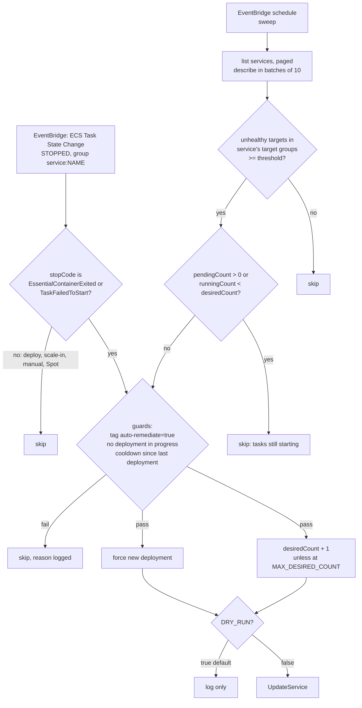

# ECS auto-remediation Lambda

A small AWS Lambda that watches ECS services and applies two controlled
fixes:

- a task in a service **crashed** → force a new deployment of that service;
- a service's **target group has unhealthy targets** → scale it out by one
  task, never past a hard maximum.

Only services tagged `auto-remediate=true` are ever touched, and the
function is **dry-run by default**.

> **Status:** ECS only. **EKS is not implemented.** 30 pytest tests drive
> the handler with fake ECS and ELBv2 clients and a fixed clock. They cover
> the opt-in tag, crash vs normal stop codes, deployment-in-progress,
> cooldown, tasks still starting, the hard maximum, pagination and batching,
> dry run, bad config, and the IAM policy's tag condition. Nothing has been deployed, and the
> function has never called real ECS or ELB APIs.

## Problem

> Write a monitoring + auto-remediation Lambda that detects failed ECS/EKS
> tasks or unhealthy target groups and triggers a controlled restart or
> scale-out.

## Flow



## Controls (no extra infrastructure)

| Control | How |
|---|---|
| Opt-in | service tag `auto-remediate=true`; untagged services are never touched. The IAM policy enforces the same tag on `ecs:UpdateService`. |
| No fighting deployments | skip when the service has more than one deployment or its primary rollout is `IN_PROGRESS` |
| Cooldown | skip when the primary deployment's `updatedAt` is newer than `COOLDOWN_MINUTES` (default 15). A forced deployment or a desired-count change updates it, so the next action waits. No state table is needed. |
| Tasks still starting | scale-out is skipped while the service has `pendingCount > 0` or `runningCount < desiredCount`. This reads live task counts only, so it works even if the deployment timestamp didn't move. |
| Hard maximum | never scale past `MAX_DESIRED_COUNT` (default 10), and only one task per action |
| Dry run | `DRY_RUN` unset or `true` logs the action without calling `UpdateService` |

Normal stops (deployments, scale-in, manual stops, Spot interruptions) are
ignored; only `EssentialContainerExited` and `TaskFailedToStart` count as
crashes.

## Usage

```bash
python -m pip install -r requirements-dev.txt
python -m ruff check .
python -m ruff format --check .
python -m pytest -q
```

Deploying is not included. To deploy by hand:

- handler `remediate.handler.handler`, runtime Python 3.12, role with
  `iam/policy.json` (placeholder account `123456789012`);
- an EventBridge rule for `ECS Task State Change` with
  `detail.lastStatus = STOPPED`, and a schedule rule (for example every 5
  minutes) for the sweep. `events/` has one sample of each.

| Env var | Default | Meaning |
|---|---|---|
| `CLUSTERS` | (none) | comma-separated clusters to sweep; required for the sweep |
| `DRY_RUN` | `true` | `false` to act; anything else is an error |
| `COOLDOWN_MINUTES` | `15` | minimum time since the last deployment change |
| `MAX_DESIRED_COUNT` | `10` | hard cap for scale-out |
| `UNHEALTHY_THRESHOLD` | `1` | unhealthy targets needed to trigger scale-out |

## Limits

- ECS only; EKS is not implemented.
- **Scale-out is never reversed by this function.** It only ever raises
  `desiredCount`; it never lowers it, even after the targets are healthy
  again. Scaling back in is left to Application Auto Scaling or a human.
- Scaling out doesn't fix a bad release. If every task is unhealthy, this
  adds tasks up to the cap; deployment circuit breakers or a rollback are the
  real fix.
- The cooldown relies on ECS updating the primary deployment's `updatedAt`
  on a desired-count change (AWS behaviour to re-verify).
- A forced deployment restarts tasks with the same task definition; it
  won't help if the crash is in the image.

## Security notes

- Opt-in by tag in code and in IAM: the role can only update services
  tagged `auto-remediate=true`.
- **Checked against AWS docs:** the service authorization reference for
  Amazon ECS ("Actions, resources, and condition keys for Amazon Elastic
  Container Service", `docs.aws.amazon.com/service-authorization/latest/reference/list_ecs.html`)
  lists `aws:ResourceTag/${TagKey}` and `ecs:ResourceTag/${TagKey}` as
  supported condition keys for `ecs:UpdateService` on the `service`
  resource, so the policy's `aws:ResourceTag/auto-remediate` condition is a
  real guard and was kept. Tag-based authorization needs services with the
  long ARN format (`service/<cluster>/<name>`), which the policy's resource
  pattern assumes.
- Read actions are limited to `ListServices`, `DescribeServices` and
  `DescribeTargetHealth`; no wildcard actions.
- No credentials in code; the Lambda role supplies them.

## Idempotency

A repeated event for the same crash, or a sweep a minute later, hits the
cooldown or the deployment-in-progress guard and does nothing, so
duplicate EventBridge deliveries don't stack restarts or scale-outs.
